

<picture><source media="(prefers-color-scheme: dark)" srcset="assets/hero-night.svg"><source media="(prefers-color-scheme: light)" srcset="assets/hero-day.svg"></picture>

<picture><source media="(prefers-color-scheme: dark)" srcset="assets/status-night.svg"><source media="(prefers-color-scheme: light)" srcset="assets/status-day.svg"></picture>

<a href="https://scholar.google.com/citations?user=V95iNggAAAAJ"><picture><source media="(prefers-color-scheme: dark)" srcset="assets/lab-night.svg"><source media="(prefers-color-scheme: light)" srcset="assets/lab-day.svg"></picture></a>
<a href="https://github.com/wjgoarxiv/litfamily"><picture><source media="(prefers-color-scheme: dark)" srcset="assets/workshop-night.svg"><source media="(prefers-color-scheme: light)" srcset="assets/workshop-day.svg"></picture></a>

<picture><source media="(prefers-color-scheme: dark)" srcset="assets/cards/hdr-projects-night.svg"><source media="(prefers-color-scheme: light)" srcset="assets/cards/hdr-projects-day.svg"></picture>

<picture><source media="(prefers-color-scheme: dark)" srcset="assets/cards/hdr-litfamily-night.svg"><source media="(prefers-color-scheme: light)" srcset="assets/cards/hdr-litfamily-day.svg"></picture>

<a href="https://github.com/wjgoarxiv/litfamily"><picture><source media="(prefers-color-scheme: dark)" srcset="assets/cards/litfamily-night.svg"><source media="(prefers-color-scheme: light)" srcset="assets/cards/litfamily-day.svg">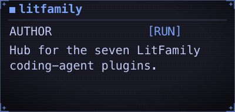</picture></a>
<a href="https://github.com/wjgoarxiv/litgravity"><picture><source media="(prefers-color-scheme: dark)" srcset="assets/cards/litgravity-night.svg"><source media="(prefers-color-scheme: light)" srcset="assets/cards/litgravity-day.svg">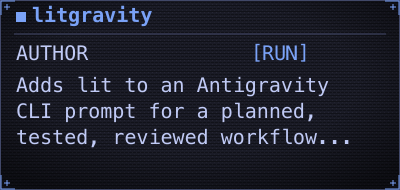</picture></a>
<a href="https://github.com/wjgoarxiv/litclaude"><picture><source media="(prefers-color-scheme: dark)" srcset="assets/cards/litclaude-night.svg"><source media="(prefers-color-scheme: light)" srcset="assets/cards/litclaude-day.svg">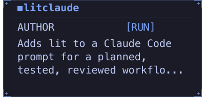</picture></a>

<a href="https://github.com/wjgoarxiv/litcodex"><picture><source media="(prefers-color-scheme: dark)" srcset="assets/cards/litcodex-night.svg"><source media="(prefers-color-scheme: light)" srcset="assets/cards/litcodex-day.svg">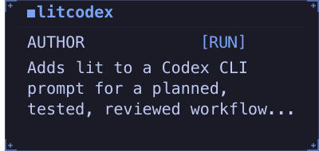</picture></a>
<a href="https://github.com/wjgoarxiv/litopencode"><picture><source media="(prefers-color-scheme: dark)" srcset="assets/cards/litopencode-night.svg"><source media="(prefers-color-scheme: light)" srcset="assets/cards/litopencode-day.svg">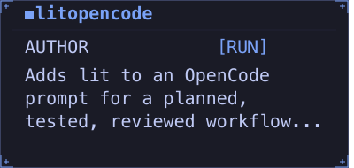</picture></a>
<a href="https://github.com/wjgoarxiv/lithermes"><picture><source media="(prefers-color-scheme: dark)" srcset="assets/cards/lithermes-night.svg"><source media="(prefers-color-scheme: light)" srcset="assets/cards/lithermes-day.svg">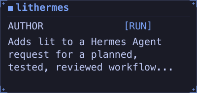</picture></a>

<a href="https://github.com/wjgoarxiv/litgrok"><picture><source media="(prefers-color-scheme: dark)" srcset="assets/cards/litgrok-night.svg"><source media="(prefers-color-scheme: light)" srcset="assets/cards/litgrok-day.svg">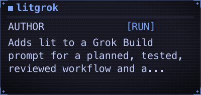</picture></a>

<picture><source media="(prefers-color-scheme: dark)" srcset="assets/cards/hdr-science-night.svg"><source media="(prefers-color-scheme: light)" srcset="assets/cards/hdr-science-day.svg"></picture>

<a href="https://github.com/wjgoarxiv/ovito-mcp"><picture><source media="(prefers-color-scheme: dark)" srcset="assets/cards/ovito-mcp-night.svg"><source media="(prefers-color-scheme: light)" srcset="assets/cards/ovito-mcp-day.svg">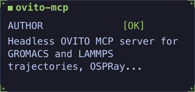</picture></a>
<a href="https://github.com/wjgoarxiv/pymol-mcp"><picture><source media="(prefers-color-scheme: dark)" srcset="assets/cards/pymol-mcp-night.svg"><source media="(prefers-color-scheme: light)" srcset="assets/cards/pymol-mcp-day.svg">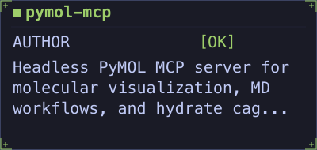</picture></a>
<a href="https://github.com/wjgoarxiv/multiflash-assistant"><picture><source media="(prefers-color-scheme: dark)" srcset="assets/cards/multiflash-assistant-night.svg"><source media="(prefers-color-scheme: light)" srcset="assets/cards/multiflash-assistant-day.svg">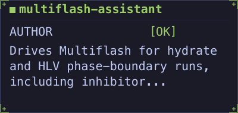</picture></a>

<a href="https://github.com/wjgoarxiv/hysys-companion-releases"><picture><source media="(prefers-color-scheme: dark)" srcset="assets/cards/hysys-companion-releases-night.svg"><source media="(prefers-color-scheme: light)" srcset="assets/cards/hysys-companion-releases-day.svg">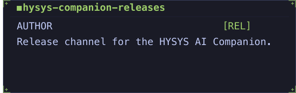</picture></a>

<picture><source media="(prefers-color-scheme: dark)" srcset="assets/cards/hdr-env-night.svg"><source media="(prefers-color-scheme: light)" srcset="assets/cards/hdr-env-day.svg"></picture>

<a href="https://github.com/wjgoarxiv/pretty-terminal"><picture><source media="(prefers-color-scheme: dark)" srcset="assets/cards/pretty-terminal-night.svg"><source media="(prefers-color-scheme: light)" srcset="assets/cards/pretty-terminal-day.svg">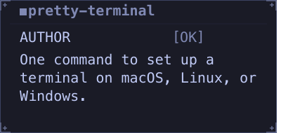</picture></a>
<a href="https://github.com/wjgoarxiv/my-tmux-settings"><picture><source media="(prefers-color-scheme: dark)" srcset="assets/cards/my-tmux-settings-night.svg"><source media="(prefers-color-scheme: light)" srcset="assets/cards/my-tmux-settings-day.svg">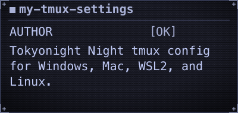</picture></a>
<a href="https://github.com/wjgoarxiv/my-nvim-settings"><picture><source media="(prefers-color-scheme: dark)" srcset="assets/cards/my-nvim-settings-night.svg"><source media="(prefers-color-scheme: light)" srcset="assets/cards/my-nvim-settings-day.svg">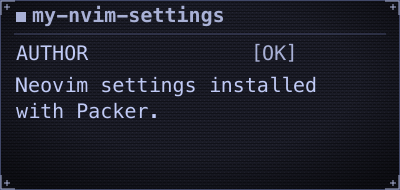</picture></a>

<a href="https://github.com/wjgoarxiv/proxlsx-skill"><picture><source media="(prefers-color-scheme: dark)" srcset="assets/cards/proxlsx-skill-night.svg"><source media="(prefers-color-scheme: light)" srcset="assets/cards/proxlsx-skill-day.svg">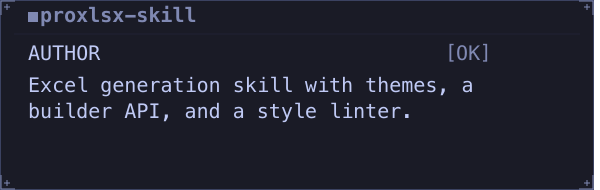</picture></a>
<a href="https://github.com/wjgoarxiv/publisher-docx-skill"><picture><source media="(prefers-color-scheme: dark)" srcset="assets/cards/publisher-docx-skill-night.svg"><source media="(prefers-color-scheme: light)" srcset="assets/cards/publisher-docx-skill-day.svg">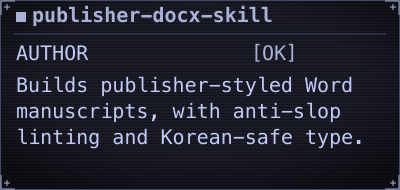</picture></a>

<picture><source media="(prefers-color-scheme: dark)" srcset="assets/cards/hdr-papers-night.svg"><source media="(prefers-color-scheme: light)" srcset="assets/cards/hdr-papers-day.svg"></picture>

<a href="https://doi.org/10.1016/j.cej.2021.134098"><picture><source media="(prefers-color-scheme: dark)" srcset="assets/papers/2021-cej-dual-inhibitors-night.svg"><source media="(prefers-color-scheme: light)" srcset="assets/papers/2021-cej-dual-inhibitors-day.svg">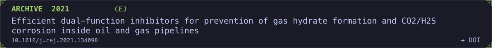</picture></a>

<a href="https://doi.org/10.1016/j.energy.2019.06.025"><picture><source media="(prefers-color-scheme: dark)" srcset="assets/papers/2019-energy-amino-acids-night.svg"><source media="(prefers-color-scheme: light)" srcset="assets/papers/2019-energy-amino-acids-day.svg">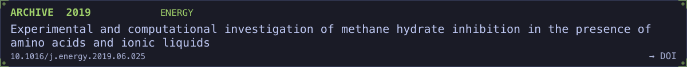</picture></a>

<a href="https://doi.org/10.1016/j.fuel.2022.125479"><picture><source media="(prefers-color-scheme: dark)" srcset="assets/papers/2022-fuel-dipeptides-night.svg"><source media="(prefers-color-scheme: light)" srcset="assets/papers/2022-fuel-dipeptides-day.svg">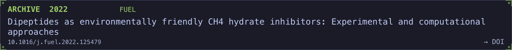</picture></a>

<a href="https://doi.org/10.1016/j.apenergy.2024.123523"><picture><source media="(prefers-color-scheme: dark)" srcset="assets/papers/2024-apenergy-oligopeptides-night.svg"><source media="(prefers-color-scheme: light)" srcset="assets/papers/2024-apenergy-oligopeptides-day.svg">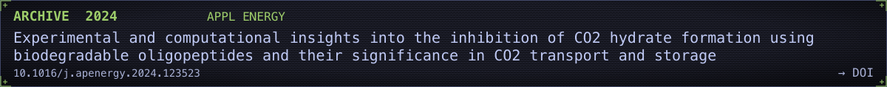</picture></a>

<a href="https://doi.org/10.1016/j.cej.2024.157251"><picture><source media="(prefers-color-scheme: dark)" srcset="assets/papers/2024-cej-co2-injection-night.svg"><source media="(prefers-color-scheme: light)" srcset="assets/papers/2024-cej-co2-injection-day.svg">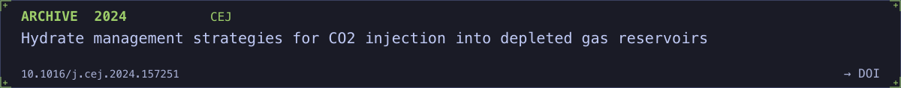</picture></a>

[full list → Google Scholar](https://scholar.google.com/citations?user=V95iNggAAAAJ)

[Homepage](https://woojingo.notion.site) · [Google Scholar](https://scholar.google.com/citations?user=V95iNggAAAAJ) · [ORCID](https://orcid.org/0000-0003-4021-8621) · [LinkedIn](https://www.linkedin.com/in/woojingo/) · [PyPI](https://pypi.org/user/wjgo/) · [ResearchGate](https://www.researchgate.net/profile/Woojin-Go) · [Mail](mailto:woo_go@yahoo.com) · [Buy Me a Coffee](https://www.buymeacoffee.com/woojingo)

── EOT ──
