


<a href="https://scholar.google.com/citations?user=V95iNggAAAAJ"></a>
<a href="https://github.com/wjgoarxiv/litfamily"></a>

<a href="https://github.com/wjgoarxiv/litfamily">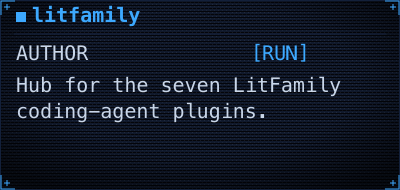</a>
<a href="https://github.com/wjgoarxiv/litgravity">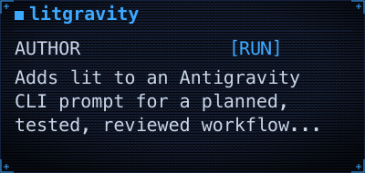</a>
<a href="https://github.com/wjgoarxiv/litclaude">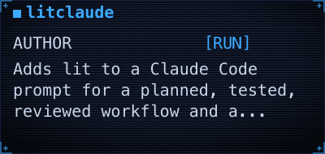</a>

<a href="https://github.com/wjgoarxiv/litcodex">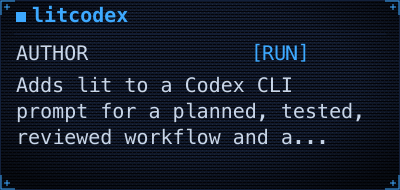</a>
<a href="https://github.com/wjgoarxiv/litopencode">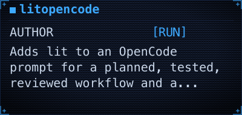</a>
<a href="https://github.com/wjgoarxiv/lithermes">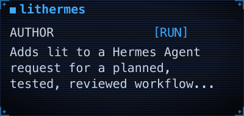</a>

<a href="https://github.com/wjgoarxiv/litgrok">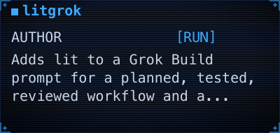</a>

<a href="https://github.com/wjgoarxiv/ovito-mcp">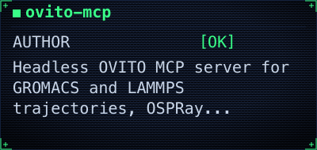</a>
<a href="https://github.com/wjgoarxiv/pymol-mcp">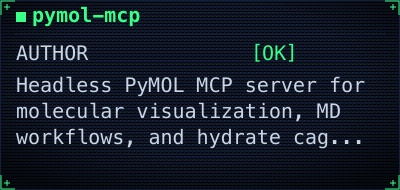</a>
<a href="https://github.com/wjgoarxiv/multiflash-assistant">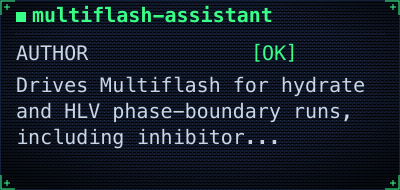</a>

<a href="https://github.com/wjgoarxiv/hysys-companion-releases">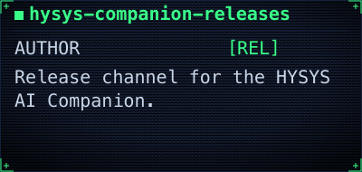</a>

<a href="https://github.com/wjgoarxiv/pretty-terminal">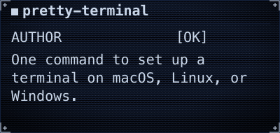</a>
<a href="https://github.com/wjgoarxiv/my-tmux-settings">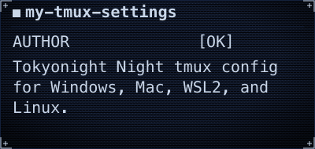</a>
<a href="https://github.com/wjgoarxiv/my-nvim-settings">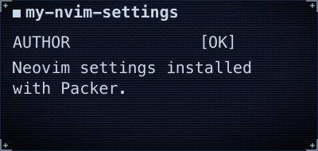</a>

<a href="https://github.com/wjgoarxiv/proxlsx-skill">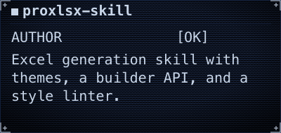</a>
<a href="https://github.com/wjgoarxiv/publisher-docx-skill">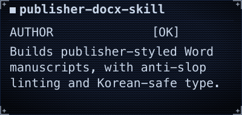</a>

<a href="https://doi.org/10.1016/j.cej.2021.134098">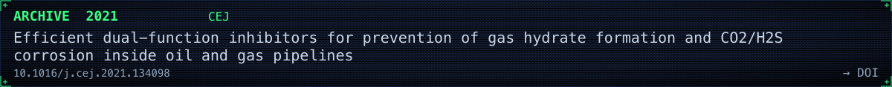</a>

<a href="https://doi.org/10.1016/j.energy.2019.06.025">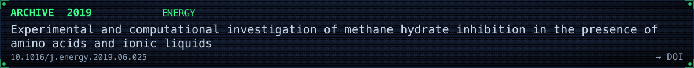</a>

<a href="https://doi.org/10.1016/j.fuel.2022.125479">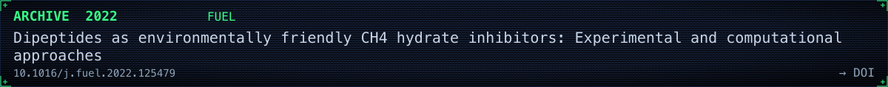</a>

<a href="https://doi.org/10.1016/j.apenergy.2024.123523">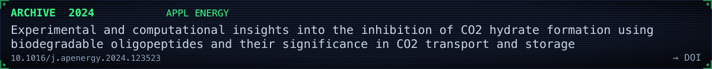</a>

<a href="https://doi.org/10.1016/j.cej.2024.157251">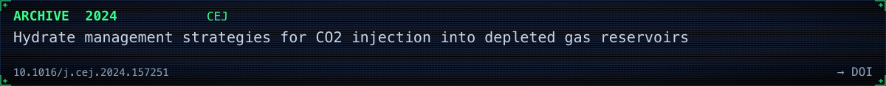</a>

[full list → Google Scholar](https://scholar.google.com/citations?user=V95iNggAAAAJ)

[Homepage](https://woojingo.notion.site) · [Google Scholar](https://scholar.google.com/citations?user=V95iNggAAAAJ) · [ORCID](https://orcid.org/0000-0003-4021-8621) · [LinkedIn](https://www.linkedin.com/in/woojingo/) · [PyPI](https://pypi.org/user/wjgo/) · [ResearchGate](https://www.researchgate.net/profile/Woojin-Go) · [Mail](mailto:woo_go@yahoo.com) · [Buy Me a Coffee](https://www.buymeacoffee.com/woojingo)

── EOT ──
