<picture><source media="(prefers-color-scheme: dark)" srcset="assets/hero-night.svg"><source media="(prefers-color-scheme: light)" srcset="assets/hero-day.svg"></picture>

<a href="https://github.com/wjgoarxiv"><picture><source media="(prefers-color-scheme: dark)" srcset="assets/badges/stars-night.svg"><source media="(prefers-color-scheme: light)" srcset="assets/badges/stars-day.svg"></picture></a><a href="https://github.com/wjgoarxiv?tab=followers"><picture><source media="(prefers-color-scheme: dark)" srcset="assets/badges/followers-night.svg"><source media="(prefers-color-scheme: light)" srcset="assets/badges/followers-day.svg"></picture></a><a href="https://github.com/wjgoarxiv/litfamily/releases"><picture><source media="(prefers-color-scheme: dark)" srcset="assets/badges/release-night.svg"><source media="(prefers-color-scheme: light)" srcset="assets/badges/release-day.svg"></picture></a><a href="https://scholar.google.com/citations?user=V95iNggAAAAJ"><picture><source media="(prefers-color-scheme: dark)" srcset="assets/badges/phd-night.svg"><source media="(prefers-color-scheme: light)" srcset="assets/badges/phd-day.svg"></picture></a><a href="https://scholar.google.com/citations?user=V95iNggAAAAJ"><picture><source media="(prefers-color-scheme: dark)" srcset="assets/badges/research-night.svg"><source media="(prefers-color-scheme: light)" srcset="assets/badges/research-day.svg"></picture></a>
 
<a href="https://woojingo.notion.site"><picture><source media="(prefers-color-scheme: dark)" srcset="assets/badges/homepage-night.svg"><source media="(prefers-color-scheme: light)" srcset="assets/badges/homepage-day.svg"></picture></a><a href="https://scholar.google.com/citations?user=V95iNggAAAAJ"><picture><source media="(prefers-color-scheme: dark)" srcset="assets/badges/scholar-night.svg"><source media="(prefers-color-scheme: light)" srcset="assets/badges/scholar-day.svg"></picture></a><a href="https://orcid.org/0000-0003-4021-8621"><picture><source media="(prefers-color-scheme: dark)" srcset="assets/badges/orcid-night.svg"><source media="(prefers-color-scheme: light)" srcset="assets/badges/orcid-day.svg"></picture></a><a href="https://www.linkedin.com/in/woojingo/"><picture><source media="(prefers-color-scheme: dark)" srcset="assets/badges/linkedin-night.svg"><source media="(prefers-color-scheme: light)" srcset="assets/badges/linkedin-day.svg"></picture></a><a href="https://pypi.org/user/wjgo/"><picture><source media="(prefers-color-scheme: dark)" srcset="assets/badges/pypi-night.svg"><source media="(prefers-color-scheme: light)" srcset="assets/badges/pypi-day.svg"></picture></a><a href="https://www.researchgate.net/profile/Woojin-Go"><picture><source media="(prefers-color-scheme: dark)" srcset="assets/badges/researchgate-night.svg"><source media="(prefers-color-scheme: light)" srcset="assets/badges/researchgate-day.svg"></picture></a><a href="mailto:woo_go@yahoo.com"><picture><source media="(prefers-color-scheme: dark)" srcset="assets/badges/mail-night.svg"><source media="(prefers-color-scheme: light)" srcset="assets/badges/mail-day.svg"></picture></a><a href="https://www.buymeacoffee.com/woojingo"><picture><source media="(prefers-color-scheme: dark)" srcset="assets/badges/coffee-night.svg"><source media="(prefers-color-scheme: light)" srcset="assets/badges/coffee-day.svg"></picture></a>

<a href="https://scholar.google.com/citations?user=V95iNggAAAAJ"><picture><source media="(prefers-color-scheme: dark)" srcset="assets/lab-night.svg"><source media="(prefers-color-scheme: light)" srcset="assets/lab-day.svg"></picture></a><a href="https://github.com/wjgoarxiv/litfamily"><picture><source media="(prefers-color-scheme: dark)" srcset="assets/workshop-night.svg"><source media="(prefers-color-scheme: light)" srcset="assets/workshop-day.svg"></picture></a>

<a href="https://github.com/wjgoarxiv?tab=overview"><picture><source media="(prefers-color-scheme: dark)" srcset="assets/contrib-night.svg"><source media="(prefers-color-scheme: light)" srcset="assets/contrib-day.svg"></picture></a>

<samp>/projects/litfamily · 7</samp>

<a href="https://github.com/wjgoarxiv/litfamily"><picture><source media="(prefers-color-scheme: dark)" srcset="assets/cards/litfamily-night.svg"><source media="(prefers-color-scheme: light)" srcset="assets/cards/litfamily-day.svg"></picture></a>

<a href="https://github.com/wjgoarxiv/litgravity"><picture><source media="(prefers-color-scheme: dark)" srcset="assets/cards/litgravity-night.svg"><source media="(prefers-color-scheme: light)" srcset="assets/cards/litgravity-day.svg"></picture></a><a href="https://github.com/wjgoarxiv/litclaude"><picture><source media="(prefers-color-scheme: dark)" srcset="assets/cards/litclaude-night.svg"><source media="(prefers-color-scheme: light)" srcset="assets/cards/litclaude-day.svg"></picture></a><a href="https://github.com/wjgoarxiv/litcodex"><picture><source media="(prefers-color-scheme: dark)" srcset="assets/cards/litcodex-night.svg"><source media="(prefers-color-scheme: light)" srcset="assets/cards/litcodex-day.svg"></picture></a>

<a href="https://github.com/wjgoarxiv/litopencode"><picture><source media="(prefers-color-scheme: dark)" srcset="assets/cards/litopencode-night.svg"><source media="(prefers-color-scheme: light)" srcset="assets/cards/litopencode-day.svg"></picture></a><a href="https://github.com/wjgoarxiv/lithermes"><picture><source media="(prefers-color-scheme: dark)" srcset="assets/cards/lithermes-night.svg"><source media="(prefers-color-scheme: light)" srcset="assets/cards/lithermes-day.svg"></picture></a><a href="https://github.com/wjgoarxiv/litgrok"><picture><source media="(prefers-color-scheme: dark)" srcset="assets/cards/litgrok-night.svg"><source media="(prefers-color-scheme: light)" srcset="assets/cards/litgrok-day.svg"></picture></a>

<samp>/projects/science-mcp · 4</samp>

<a href="https://github.com/wjgoarxiv/ovito-mcp"><picture><source media="(prefers-color-scheme: dark)" srcset="assets/cards/ovito-mcp-night.svg"><source media="(prefers-color-scheme: light)" srcset="assets/cards/ovito-mcp-day.svg"></picture></a><a href="https://github.com/wjgoarxiv/pymol-mcp"><picture><source media="(prefers-color-scheme: dark)" srcset="assets/cards/pymol-mcp-night.svg"><source media="(prefers-color-scheme: light)" srcset="assets/cards/pymol-mcp-day.svg"></picture></a>

<a href="https://github.com/wjgoarxiv/multiflash-assistant"><picture><source media="(prefers-color-scheme: dark)" srcset="assets/cards/multiflash-assistant-night.svg"><source media="(prefers-color-scheme: light)" srcset="assets/cards/multiflash-assistant-day.svg"></picture></a><a href="https://github.com/wjgoarxiv/hysys-companion-releases"><picture><source media="(prefers-color-scheme: dark)" srcset="assets/cards/hysys-companion-releases-night.svg"><source media="(prefers-color-scheme: light)" srcset="assets/cards/hysys-companion-releases-day.svg"></picture></a>

<samp>/projects/env · 5</samp>

<a href="https://github.com/wjgoarxiv/pretty-terminal"><picture><source media="(prefers-color-scheme: dark)" srcset="assets/cards/pretty-terminal-night.svg"><source media="(prefers-color-scheme: light)" srcset="assets/cards/pretty-terminal-day.svg"></picture></a><a href="https://github.com/wjgoarxiv/my-tmux-settings"><picture><source media="(prefers-color-scheme: dark)" srcset="assets/cards/my-tmux-settings-night.svg"><source media="(prefers-color-scheme: light)" srcset="assets/cards/my-tmux-settings-day.svg"></picture></a><a href="https://github.com/wjgoarxiv/my-nvim-settings"><picture><source media="(prefers-color-scheme: dark)" srcset="assets/cards/my-nvim-settings-night.svg"><source media="(prefers-color-scheme: light)" srcset="assets/cards/my-nvim-settings-day.svg"></picture></a>

<a href="https://github.com/wjgoarxiv/proxlsx-skill"><picture><source media="(prefers-color-scheme: dark)" srcset="assets/cards/proxlsx-skill-night.svg"><source media="(prefers-color-scheme: light)" srcset="assets/cards/proxlsx-skill-day.svg"></picture></a><a href="https://github.com/wjgoarxiv/publisher-docx-skill"><picture><source media="(prefers-color-scheme: dark)" srcset="assets/cards/publisher-docx-skill-night.svg"><source media="(prefers-color-scheme: light)" srcset="assets/cards/publisher-docx-skill-day.svg"></picture></a>

<samp>/papers · 5</samp>

<a href="https://doi.org/10.1016/j.cej.2021.134098"><picture><source media="(prefers-color-scheme: dark)" srcset="assets/papers/2021-cej-dual-inhibitors-night.svg"><source media="(prefers-color-scheme: light)" srcset="assets/papers/2021-cej-dual-inhibitors-day.svg"></picture></a>

<a href="https://doi.org/10.1016/j.energy.2019.06.025"><picture><source media="(prefers-color-scheme: dark)" srcset="assets/papers/2019-energy-amino-acids-night.svg"><source media="(prefers-color-scheme: light)" srcset="assets/papers/2019-energy-amino-acids-day.svg"></picture></a>

<a href="https://doi.org/10.1016/j.fuel.2022.125479"><picture><source media="(prefers-color-scheme: dark)" srcset="assets/papers/2022-fuel-dipeptides-night.svg"><source media="(prefers-color-scheme: light)" srcset="assets/papers/2022-fuel-dipeptides-day.svg"></picture></a>

<a href="https://doi.org/10.1016/j.apenergy.2024.123523"><picture><source media="(prefers-color-scheme: dark)" srcset="assets/papers/2024-apenergy-oligopeptides-night.svg"><source media="(prefers-color-scheme: light)" srcset="assets/papers/2024-apenergy-oligopeptides-day.svg"></picture></a>

<a href="https://doi.org/10.1016/j.cej.2024.157251"><picture><source media="(prefers-color-scheme: dark)" srcset="assets/papers/2024-cej-co2-injection-night.svg"><source media="(prefers-color-scheme: light)" srcset="assets/papers/2024-cej-co2-injection-day.svg"></picture></a>

[full list → Google Scholar](https://scholar.google.com/citations?user=V95iNggAAAAJ)

<picture><source media="(prefers-color-scheme: dark)" srcset="assets/footer-night.svg"><source media="(prefers-color-scheme: light)" srcset="assets/footer-day.svg"></picture>

